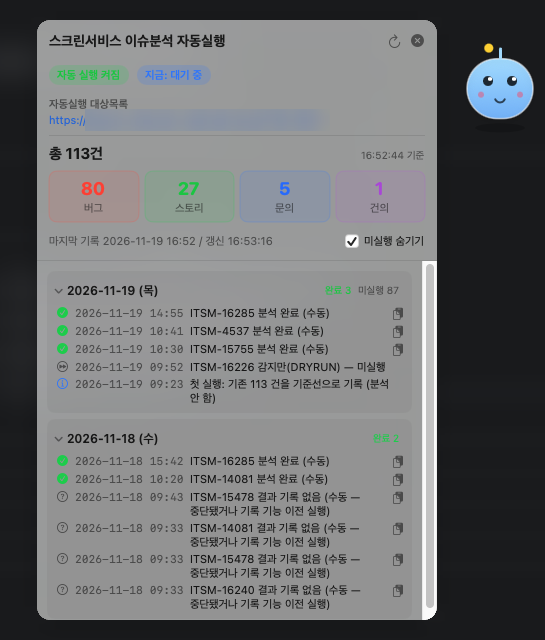

# Jira 운영 이슈 분석 자동화

> **작성일** : 2026-11-25

> **목적** : AI Agent가 Jira 운영 이슈를 자동으로 분석·보고하고, 분석한 세션의 컨텍스트를 그대로 이어 수정까지 진행할 수 있도록 구현

> **핵심 흐름** : 신규 티켓 감지 → Claude Code 분석 → Slack 보고서 작성 → 세션 재개 후 수정

---

### 1. 구성

| 구분 | 도구 | 용도 |
|------|------|------|
| 스케줄러 | launchd (macOS) | 평일 업무 시간에 5분 간격으로 감지 스크립트 실행 |
| 실행 스크립트 | Bash | 신규 티켓 감지, 분석 실행 |
| AI | Claude Code (`claude -p`) | 신규 티켓 확인(Haiku), 이슈 분석(Opus) |
| 분석 규칙 | Skill (`jira-analyze`) | 판정 기준, 보고서 형식, 금지 규칙 |
| 참조 목록 | `map/` (YAML, JSON) | 분석 대상을 찾기 위한 Repo·DB·서버 호스트 정보 |
| 상태 화면 | Swift (SwiftUI) | 실행 기록 표시, 세션 재개 명령어 복사 |

- **`map/`**: 스크립트로 생성한 참조 목록
  - Repo: 로컬 클론 경로, GitLab 주소, 분류
  - DB: DBHub 연결별 DB 목록 (DEV/QA)
  - 서버 호스트: 서버 구성 Google 시트를 gws CLI로 참조하여 생성

---

### 2. 실행 흐름

```
launchd (5분 간격)
  → poll.sh           : 신규 티켓 감지 (이미 확인한 티켓과 비교)
  → analyze.sh 티켓키  : claude -p로 이슈 분석
  → Slack             : 분석 결과 메시지 및 보고서 작성
```

- `--allowedTools`로 허용한 도구 안에서 필요한 도구를 Claude Code가 직접 판단하여 호출
- Slack 보고서 작성 외에는 읽기 전용으로 동작 (Repo 수정 X, LIVE DB 조회 X, Jira·Confluence 작성 X)

---

### 3. 근거 수집

| 도구 | 확인 내용 | 호출 조건 |
|------|-----------|-----------|
| Jira (Atlassian 플러그인) | 티켓 본문, 댓글, 첨부, 연결 이슈 | 항상 |
| Git (로컬 클론) | fetch 후 원격 기본 브랜치(ex. `origin/main`) 기준 소스 코드 | 항상 |
| DB 플러그인 (DBHub) | SP·테이블 구조, 건수 (DEV/QA) | 데이터 확인 필요 시 |
| Dynatrace CLI (`dtctl`) | LIVE 로그 | LIVE 버그일 때 |
| Confluence (Atlassian 플러그인), Slack (플러그인) | 관련 문서·대화 | 추가 근거 필요 시 |
| Jira 릴리스 티켓 (Atlassian 플러그인) | 다른 티켓의 LIVE 배포로 이미 해결됐는지 여부 | 필요 시 |

- **DB 플러그인**: DBHub를 감싼 사내 플러그인
  - DEV/QA별 호스트·포트와 DB 설명 정의
  - 개인 계정 정보는 키체인에 저장

---

### 4. 판정·보고

| 항목 | 내용 |
|------|------|
| 판정 | `[확정]` / `[추정]` / `[미확정]` + 결론 (수정 필요, 이슈 아님, 이미 해결됨 등) |
| 근거 부족 시 | 추가로 필요한 정보와 사람이 결정할 항목을 보고서에 명시 |
| 채널 메시지 | 사용 도구, 원인 분석 결과 기록 |
| 전체보고서 버튼 | 클릭 시 Slack 캔버스에서 상세 내용 확인 |
| 재분석 | 기존 메시지 스레드에 답글로 기록 |

---

### 5. 세션 재개 후 수정

- 상태 화면의 복사 버튼으로 명령어 복사 후 터미널에서 실행
  ```shell
  EX)
  $ cd <프로젝트 경로> && tools/open-session.py ITSM-1234
  ```
- 분석한 세션의 컨텍스트를 그대로 유지한 채 질문·수정 진행

---

### 6. 결과 화면

- 자동 실행 상태, 대상 목록, 유형별 건수, 날짜별 실행 기록 표시


